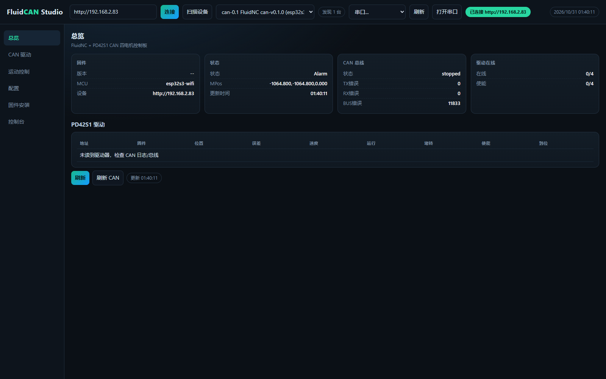

# FluidCAN Studio

Rust + Tauri 的 FluidNC CAN 调试/控制/安装工具，面向 ESP32-S3 + 4×PD42S1。

界面是网页样式：Tauri 原生窗口加载同一套 HTML/CSS/JS，功能与 Web 模式完全一致。

Windows GUI 使用 `windows_subsystem = "windows"`，启动时**不会额外弹出终端/控制台窗口**。



## 功能

- 连接 FluidNC：`http://192.168.2.83` 或任意地址
- 总览：固件版本、状态、MPos、CAN 总线错误计数、驱动在线/使能数量
- PD42S1 驱动表：地址、固件、位置、误差、速度、运行状态、堵转、使能、到位
- CAN：`$CANStatus`、`$CANFaults`、`$CANPos`、`$CANDriverInfo`、`$CANScan`、`$CANAutoConfig`、`$CANReset`、`$CANLog`
- 运动控制：X/Y/Z 点动、回零、解锁、使能/失能、任意命令
- 配置：读取/编辑/上传 `config.yaml`，上传前 YAML 语法检查
- 远程仓库 OTA：从 GitHub Releases 读取 `can-vX.Y.Z`，下载 `firmware.bin` OTA；API 限流时回退 `releases.atom`
- 网络 OTA：本地 `.bin` 上传到 `/updatefw`
- 串口烧录：esptool 写内置 factory 镜像到 `0x0`
- 内置 **fluid-installer**：已适配本仓库固件 manifest
- 串口控制台与日志

## 两种运行模式（同一二进制）

### 桌面 GUI（默认）

```powershell
.\fluidcan-studio.exe
```

- 启动内置 Axum 服务（127.0.0.1 随机端口）
- Tauri 窗口加载该页面
- 不需要浏览器

### Web / 远程模式

```powershell
.\fluidcan-studio.exe --web
```

或：

```powershell
$env:FLUIDCAN_MODE="web"
.\fluidcan-studio.exe
```

- 监听 `0.0.0.0:8088`
- 自动生成访问 token，并打印：
  `http://<本机IP>:8088/?token=...`
- 浏览器打开带 token 的地址；token 会写入 HttpOnly Cookie，后续 API/installer 请求自动带认证
- 无 `DISPLAY` / `WAYLAND_DISPLAY` 的 Linux 环境会自动进入 Web 模式

### 远程访问

```powershell
$env:FLUIDCAN_WEB_HOST="0.0.0.0"
$env:FLUIDCAN_WEB_PORT="8088"
$env:FLUIDCAN_WEB_TOKEN="自定义token"
.\fluidcan-studio.exe --web
```

开放到公网时请自行加防火墙/VPN/反向代理；内置 token 只做基础访问保护。

Web 模式不会打开终端窗口；启动 URL/token 会写入：

```text
%TEMP%\fluidcan-studio.log
```

如果当前系统有桌面，会自动用浏览器打开本地带 token 的地址。

## 单文件与内置资源

发布版 `fluidcan-studio.exe` 已通过 `rust-embed` 内置：

- 前端 HTML/CSS/JS
- fluid-installer 静态站点
- `firmware.bin`
- `firmware.factory.bin`
- `bootloader.bin`
- `partitions.bin`

运行时不依赖项目目录、`C:\FluidNC` 或 `installer-dist` 路径。复制 exe 到任意目录即可运行。

Windows 上 Tauri 使用系统 WebView2；现代 Windows 10/11 通常已安装。NSIS 安装包会在缺失时引导安装 WebView2。

## 构建

### Windows 单文件/安装包

```powershell
cargo build --release
npx @tauri-apps/cli build --bundles nsis
```

产物：

- `target/release/fluidcan-studio.exe`（便携单文件）
- `target/release/bundle/nsis/*-setup.exe`（安装包）

已放入 `dist/`：

- `dist/FluidCAN-Studio-portable.exe`
- `dist/FluidCAN-Studio_0.1.0_x64-setup.exe`

### Linux deb/rpm/AppImage 与跨架构

[.github/workflows/release.yml](.github/workflows/release.yml) 已配置：

- Windows x64 NSIS
- Linux x64 + arm64：deb / rpm / AppImage
- macOS x64 + arm64：dmg

触发方式：

```powershell
git tag studio-v0.1.0
git push origin studio-v0.1.0
```

Linux 上 Tauri 依赖 WebKitGTK/GTK；因此 **Linux GUI 不是完全静态二进制**，而是 deb/rpm/AppImage 包。完全无桌面的 headless Web 模式仍由同一二进制运行。

'
## Android / Xiaomi HyperOS

Android 是独立构建版本，但复用同一套 Rust 后端、网页 UI 和内置资源。

APK：

- `dist/FluidCAN-Studio-android-arm64.apk`

适配项（参考小米澎湃OS Android 15 应用适配指南）：

- `minSdk 24`，`targetSdk 35`，`compileSdk 36`
- AArch64 原生库，16 KB page size 对齐 [已用 `zipalign -c -P 16` 验证]
- `enableEdgeToEdge()` + CSS `env(safe-area-inset-*)` 安全区
- 局域网 HTTP 访问设备：`usesCleartextTraffic=true` + Network Security Config
- `enableOnBackInvokedCallback=true`，保留预测性返回
- Android 上使用内置 `127.0.0.1` Axum 服务，WebView 打开同一 UI

构建：

```powershell
npm install
.\scripts\build-android.ps1
```

Windows 中文路径下 NDK 链接器会报错；脚本会自动复制到 ASCII 路径构建。

说明：

- 当前 APK 使用测试签名，正式发布需要配置自己的 keystore。
- Android 端重点是 Wi-Fi 连接控制器、CAN/运动/配置/OTA；Web Serial 和 USB 串口烧录不作为 Android 主路径。
- 小米澎湃OS 适配文档：
  - <https://dev.mi.com/xiaomihyperos/documentation/detail?pId=1826>
  - <https://dev.mi.com/xiaomihyperos/documentation>
'\n## 环境变量

| 变量 | 默认 | 说明 |
|---|---|---|
| `FLUIDCAN_DEVICE` | `http://192.168.2.83` | 初始控制器地址 |
| `FLUIDCAN_MODE` | 空 | `web` 强制 Web 模式 |
| `FLUIDCAN_WEB_HOST` | `0.0.0.0` | Web 监听地址 |
| `FLUIDCAN_WEB_PORT` | `8088` | Web 端口 |
| `FLUIDCAN_WEB_TOKEN` | 自动生成 | Web 访问 token |
| `FLUIDCAN_PYTHON` | `python` | esptool 调用的 Python |
| `GITHUB_TOKEN` | 空 | 可选，提高 GitHub API 限额 |

## fluid-installer

`installer-src/` 是 [breiler/fluid-installer](https://github.com/breiler/fluid-installer) 的最小改动副本：

- release/manifest 改成本地 `/installer-api/...`
- `BrowserRouter basename="/installer"`
- 去掉 Windows 下失败的 Parcel static 复制插件

构建结果已嵌入二进制，不再需要外部 `installer-dist`。

## 注意

- 修改 `config.yaml` 前先备份，上传后重启控制器生效。
- 设备未接 CAN 驱动器时显示 `no devices` 是正常的。
- fluid-installer 的 Web Serial 烧录需要 Chrome/Edge 且设备 USB 连接。
- GUI 模式与 Web 模式是同一个二进制、同一套功能，没有拆分。


