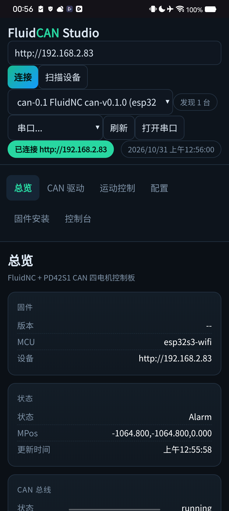

# FluidCAN Studio

Rust + Tauri 的 FluidNC CAN 调试、控制、配置与固件安装工具，面向 ESP32-S3 + 4×PD42S1 CAN 控制板。

界面是网页样式：Tauri 原生窗口加载同一套 HTML/CSS/JS，桌面 GUI 和 Web 远程模式共用同一套 Rust 后端与前端资源。


当前版本：`studio-v0.2.6`

## 功能

- **自动扫描设备**：启动后按本机 /24 局域网探测 `$I`，识别 FluidNC 并自动填入地址、自动连接
- 手动输入控制器地址
- 总览：固件版本、状态、MPos、CAN 总线错误计数、驱动在线/使能数量
- PD42S1 驱动表：地址、轴身份（X/Y0/Y1/Z）、固件、位置、误差、速度、运行状态、堵转、使能、到位
- CAN：`$CANStatus`、`$CANFaults`、`$CANPos`、`$CANDriverInfo`、`$CANScan`、`$CANAutoConfig`、`$CANReset`、`$CANLog`
- 双 Y 配置面板：只读解析 config.yaml，显示 Y0/Y1 地址、counts_per_step、方向、block target、sync_group、力矩/PID，并警告自动分组字段和地址/方向不一致
- 运动控制：X/Y/Z 点动、回零、解锁、使能/失能、X/Y/Z 单独工作坐标清零（G10 L20 P1）和驱动零位（$CANZero，清 PD42S1 编码器后自动坐标零）、任意命令
- 配置：读取/编辑/上传 `config.yaml`，上传前 YAML 语法检查
- 远程仓库 OTA：从 GitHub Releases 读取 `can-vX.Y.Z`，下载 `firmware.bin` OTA；GitHub API 限流时回退 `releases.atom`
- 网络 OTA：本地 `.bin` 上传到设备 `/updatefw`
- 串口烧录：esptool 写内置 factory 镜像到 `0x0`
- 内置 **fluid-installer**：已适配本仓库固件 manifest
- 串口控制台与日志

## 运行模式

### 桌面 GUI（默认）

```powershell
.\fluidcan-studio.exe
```

- 启动内置 Axum 服务（`127.0.0.1` 随机端口）
- Tauri 窗口加载页面
- 不打开额外终端
- Windows 使用 `windows_subsystem = "windows"`，双击只出现应用窗口

### Web / 远程模式

```powershell
.\fluidcan-studio.exe --web
```

或：

```powershell
$env:FLUIDCAN_MODE="web"
.\fluidcan-studio.exe
```

- 默认监听 `0.0.0.0:8088`
- 自动生成访问 token
- 输出本机和局域网访问地址，例如：
  `http://192.168.x.x:8088/?token=...`
- token 写入 HttpOnly Cookie，后续 API / installer 请求自动认证
- 启动 URL 和 token 同时写入：
  `%TEMP%\fluidcan-studio.log`
- Linux 无 `DISPLAY` / `WAYLAND_DISPLAY` 时自动进入 Web 模式

开放到公网时请加防火墙、VPN 或反向代理；内置 token 只做基础访问保护。

## 单文件与内置资源

发布版 `fluidcan-studio.exe` 通过 `rust-embed` 内置：

- 前端 HTML/CSS/JS
- fluid-installer 静态站点
- `firmware.bin`
- `firmware.factory.bin`
- `bootloader.bin`
- `partitions.bin`

运行时不依赖项目目录、`C:\FluidNC` 或 `installer-dist` 路径，复制 exe 到任意目录即可运行。

Windows 使用系统 WebView2；现代 Windows 10/11 通常已安装。NSIS 安装包会在缺失时引导安装 WebView2。

## 构建

### Windows 单文件/安装包

```powershell
cargo build --release
npx @tauri-apps/cli build --bundles nsis
```

产物：

- `target/release/fluidcan-studio.exe`（便携单文件）
- `target/release/bundle/nsis/*-setup.exe`（安装包）

已放入 `dist/` 的文件：

- `dist/FluidCAN-Studio-portable.exe`
- `dist/FluidCAN-Studio_0.1.0_x64-setup.exe`
- `dist/FluidCAN-Studio-android-arm64.apk`

### Android

```powershell
npm install
.\scripts\build-android.ps1
```

脚本会自动处理：

- Windows 中文路径下 NDK 链接失败（复制到 ASCII 工作目录构建）
- Java / Android SDK / NDK 环境
- ARM64 APK 构建
- 测试签名
- 16 KB 页对齐检查

产物：

```text
dist/FluidCAN-Studio-android-arm64.apk
```

### CI / 跨平台发布

工作流：[.github/workflows/build.yml](.github/workflows/build.yml)

构建矩阵：

- Windows x64 / ARM64：NSIS + 便携 exe
- Linux x64 / ARM64：deb / rpm / AppImage
- macOS x64 / ARM64：dmg
- Android ARM64：APK

发布流程：

1. `checks` 检查代码与内置资源
2. 各平台独立编译并上传 artifact
3. `release` 只收集正式安装包，上传前校验数量与扩展名
4. `ci-passed` / “全平台编译检查”用 ✅/⏭️/❌/⚪ + 文字输出汇总

触发：

```powershell
git tag studio-v0.2.1
git push origin studio-v0.2.1
```

依赖的 Actions 使用当前最新大版本，包括：

- `actions/checkout@v5`
- `actions/setup-python@v6`
- `actions/setup-java@v6`
- `actions/upload-artifact@v6`
- `actions/download-artifact@v7`
- `softprops/action-gh-release@v3`
- `android-actions/setup-android@v4`

Linux GUI 依赖 WebKitGTK/GTK，因此发布为 deb/rpm/AppImage，不是完全静态二进制；无桌面的 headless Web 模式仍由同一二进制运行。

## Android / Xiaomi HyperOS

Android 是独立构建版本，复用同一套 Rust 后端、网页 UI 和内置资源。



适配项（参考小米澎湃OS Android 17 应用适配指南）：

- `minSdk 24`，`targetSdk 37`，`compileSdk 37`
- AArch64 原生库，16 KB page size 对齐（已用 `zipalign -c -P 16` 验证）
- `enableEdgeToEdge()` + 原生 `WindowInsets` 安全区（不重复叠加 CSS safe-area）
- 局域网 HTTP：仅使用 Network Security Config（已移除对 `usesCleartextTraffic` 的依赖）
- `ACCESS_LOCAL_NETWORK` 运行时权限（targetSdk 37 必需）
- `enableOnBackInvokedCallback=true`，保留预测性返回
- Android 上启动内置 `127.0.0.1` Axum 服务，WebView 加载同一 UI

已在 Xiaomi `25098PN5AC` / HyperOS `OS4.0.5.0.XBLCNXM`（Android 17 / SDK 37）实测：

- APK 安装、启动成功
- 启动后自动扫描局域网并发现控制器
- 自动连接后读取状态、MPos、CAN running
- 状态栏安全区正常，无顶部空白
- `ACCESS_LOCAL_NETWORK` 授权后扫描和局域网请求正常

说明：

- 当前 APK 使用测试签名；正式上架需要配置自己的 keystore。
- Android 主要使用 Wi-Fi 连接控制器、CAN、运动、配置和 OTA。
- Web Serial 和 USB 串口烧录不作为 Android 主路径。
- 小米澎湃OS 文档：
  - [Android 17 应用适配指南](https://dev.mi.com/xiaomihyperos/documentation/detail?pId=2297)
  - [小米澎湃OS开发者文档](https://dev.mi.com/xiaomihyperos/documentation)

## 设备扫描

后端接口：

```text
GET /api/scan
```

行为：

- 优先选择 `192.168.x.x`，再尝试 `10.x`、`172.16-31.x`
- 扫描本机所在 `/24` 网段
- 请求每个地址的 `/command?plain=$I`
- 识别返回 `[VER:` 或包含 `FluidNC` 的设备
- 返回 `{ ip, url, version }`

前端启动时自动扫描；扫描到一台时自动连接；多台时通过下拉框选择。


## I2C / OLED 说明

- `wifi_s3` 标准固件：已编译 I2C 总线驱动，但不包含 OLED 显示模块
- `wifi_s3_oled` 固件：在 `wifi_s3` 基础上加入 `esp32/OLED.cpp`，用于 OLED 版本
- 硬件配置：
  - I2C0：SDA `gpio.8`，SCL `gpio.9`，100 kHz
  - OLED：地址 `0x3C`（60），128×64
- 远程 Release `can-v0.1.1` 起使用 `wifi_s3_oled` 构建，`can-v0.1.2` 修复了 `$I2CScan` 的 ACK 判断\n- `$I2CScan` 现在同时做硬件 I2C 和 bit-bang 扫描（含 SDA/SCL 交换），便于区分固件和硬件问题
- 配置中的 `oled:` 段和 `i2c0:` 段必须同时存在，否则 OLED 不会初始化

如果屏幕不亮，优先检查 IO8/9 接线、模块供电、I2C 地址和 `$I2CScan` 结果。
## 环境变量

| 变量 | 默认 | 说明 |
|---|---|---|
| `FLUIDCAN_DEVICE` | 空（自动扫描） | 可选，手动指定初始控制器地址 |
| `FLUIDCAN_MODE` | 空 | `web` 强制 Web 模式 |
| `FLUIDCAN_WEB_HOST` | `0.0.0.0` | Web 监听地址 |
| `FLUIDCAN_WEB_PORT` | `8088` | Web 端口 |
| `FLUIDCAN_WEB_TOKEN` | 自动生成 | Web 访问 token |
| `FLUIDCAN_PYTHON` | `python` | esptool 调用的 Python |
| `GITHUB_TOKEN` | 空 | 可选，提高 GitHub API 限额 |

## fluid-installer

`installer-src/` 是 [breiler/fluid-installer](https://github.com/breiler/fluid-installer) 的最小改动副本：

- release/manifest 改成本地 `/installer-api/...`
- `BrowserRouter basename="/installer"`
- 去掉 Windows 下失败的 Parcel static 复制插件

构建结果已嵌入二进制，不再需要外部 `installer-dist`。

## 注意

- 修改 `config.yaml` 前先备份，上传后重启控制器生效。
- 设备未接 CAN 驱动器时显示 `no devices` 是正常的。
- fluid-installer 的 Web Serial 烧录需要 Chrome/Edge，并且设备通过 USB 连接。
- GUI、Web、Android 共用同一套功能和后端，不做功能拆分。


