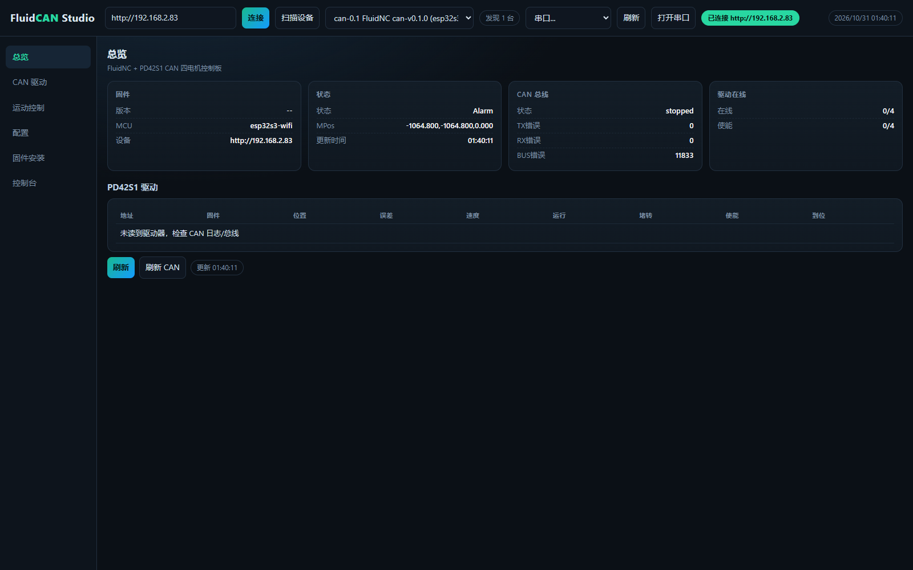
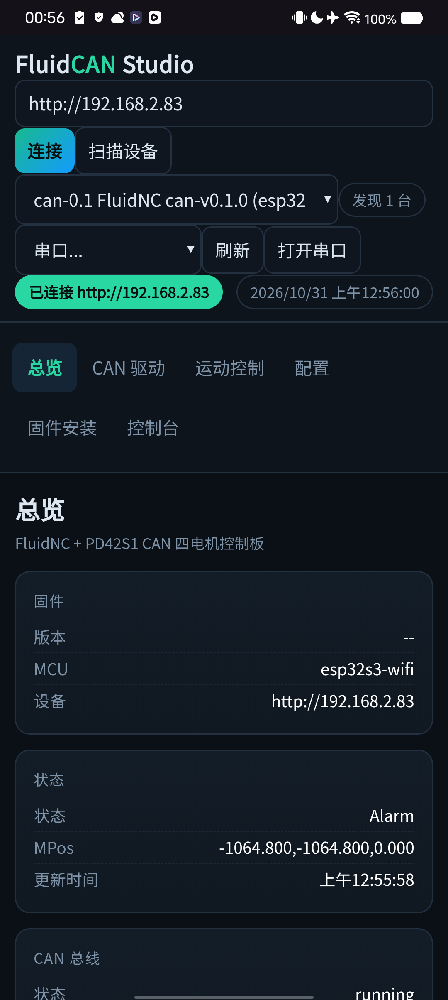

# FluidCAN Studio

Rust + Tauri 的 FluidNC CAN 调试、控制、配置与固件安装工具，面向 ESP32-S3 + 通用 CAN 电机控制板（PD42S1 / ZDT / CANopen）。

界面是网页样式：Tauri 原生窗口加载同一套 HTML/CSS/JS，桌面 GUI 和 Web 远程模式共用同一套 Rust 后端与前端资源。



当前版本：`studio-v0.4.2`

## 功能

- **设备扫描**：启动后按本机 /24 局域网探测 `$I`，只发现 FluidNC 设备并填入“扫描结果”；连接由用户手动点击“连接”
- 手动输入控制器地址
- 总览：固件版本、状态、MPos、CAN 总线状态、驱动在线数量（分母来自 config.yaml 的驱动器数量）；不同协议只显示其支持的遥测
- 通用 CAN 驱动表：地址、轴身份、协议、位置；PD42S1 额外显示误差/速度/运行/堵转/使能/到位，ZDT 位置格式单独解析，CANopen 预留
- CAN：`$CANStatus`、`$CANFaults`、`$CANPos`、`$CANDriverInfo`、`$CANScan`、`$CANAutoConfig`、`$CANReset`、`$CANLog`
- CAN 配置面板：只读解析 config.yaml，按 can.driver 和每轴 motorN 的 pd42s1/zdt/canopen 块显示地址、协议字段、方向、速度/加速度/更新周期；警告协议混用、地址重复和方向不一致
- 运动控制：点动、回零、解锁、使能/失能、工作坐标清零（G10 L20 P1）和驱动零位（$CANZero，按驱动协议清位置基准后自动坐标零）、任意命令；轴列表和 $CANZero 地址由 config.yaml 生成
- **限位开关测试（只读）**：轮询 `?` 状态中的 `Pn:` 触发位，配合 config.yaml 里的 limit_all/neg/pos 引脚显示各轴触发/释放，不会自动移动电机
- 配置：读取/编辑/上传 `config.yaml`，上传前 YAML 语法检查
- 远程仓库 OTA：从 GitHub Releases 读取 `can-vX.Y.Z`，`can-v0.2.16+` 自动下载结构化 zip 并提取 `OTA/firmware.bin` 上传；旧版本回退 `firmware.bin`/`{variant}-firmware.bin`；GitHub API 限流时回退 `releases.atom`
- 网络 OTA：本地 `.bin` 或 Release `.zip`（自动提取 `OTA/firmware.bin`）上传到设备 `/updatefw`
- 串口烧录：esptool 写本地 factory 镜像到 `0x0`（选择本地 `.bin` 或含 `firmware.factory.bin` 的 `.zip`）
- **浏览器 Web Serial 烧录**：内嵌 esp-web-tools 组件，直接用浏览器烧录用户提供的本地固件包（标准命名 `.zip` 或单个 `.bin`），可只勾选需要更新的分区；也支持 GitHub Release 的 factory 镜像（Chrome/Edge，无需 Python/esptool）
- 串口控制台与日志

## OTA / Release 包格式（can-v0.2.16+）

`can-v0.2.16` 起 Release 不再发布散装 bin，每个变体只有一个结构化 zip，例如 `fluidcan-can-v0.2.16-nopsram-oled-usb-4mb.zip`：

```text
<variant>/
  README.txt
  OTA/
    firmware.bin          # 应用镜像，OTA 用，写入 0x10000
    firmware.addrinfo
    manifest.json
    README.txt
    SHA256SUMS
  USB/
    firmware.factory.bin  # 完整镜像，USB/Web Serial 用，写入 0x0
    bootloader.bin        # 实际位于 0x0（factory 内可验证；README 里 0x1000 为笔误）
    partitions.bin        # 0x8000
    firmware.addrinfo
    manifest.json
    README.txt
    SHA256SUMS
```

- 远程 OTA：Studio 自动下载对应变体 zip 并提取 `OTA/firmware.bin`；`can-v0.2.16` 之前仍回退散装 `firmware.bin`/`{variant}-firmware.bin`
- 本地 OTA：可直接上传上述 Release zip（自动提取 `OTA/firmware.bin`）或 app `.bin`
- Web Serial / 串口烧录：可直接选择上述 Release zip，Studio 按标准文件名识别 `USB/` 和 `OTA/` 子目录
- 4 MB 变体（`nopsram-oled-usb-4mb` 等）只有单 app 分区，**不能网络 OTA**；用 USB factory 或 Web Serial

## 运行模式

### 桌面 GUI（默认）

```powershell
.\fluidcan-studio.exe
```

- 启动内置 Axum 服务（`127.0.0.1` 随机端口）
- Tauri 窗口加载页面
- 不打开额外终端
- Windows 使用 `windows_subsystem = "windows"`，双击只出现应用窗口

### Web / 远程模式

```powershell
.\fluidcan-studio.exe --web
```

或：

```powershell
$env:FLUIDCAN_MODE="web"
.\fluidcan-studio.exe
```

- 默认监听 `0.0.0.0:8088`
- 自动生成访问 token
- 输出本机和局域网访问地址，例如：
  `http://192.168.x.x:8088/?token=...`
- token 写入 HttpOnly Cookie，后续 API / installer 请求自动认证
- 启动 URL 和 token 同时写入：
  `%TEMP%\fluidcan-studio.log`
- Linux 无 `DISPLAY` / `WAYLAND_DISPLAY` 时自动进入 Web 模式

开放到公网时请加防火墙、VPN 或反向代理；内置 token 只做基础访问保护。

## 单文件与内置资源

发布版 `fluidcan-studio.exe` 通过 `rust-embed` 内置：

- 前端 HTML/CSS/JS（含内嵌的 esp-web-tools Web Serial 组件 `ui/js/vendor/`）

Studio **不再捆绑固件**：固件由用户在界面中选择本地 `.zip` / `.bin`（或从 GitHub Release 选择 factory 镜像）后烧录。

运行时不依赖项目目录或 `C:\FluidNC` 路径，复制 exe 到任意目录即可运行。

Windows 使用系统 WebView2；现代 Windows 10/11 通常已安装。NSIS 安装包会在缺失时引导安装 WebView2。

## 构建

### Windows 单文件/安装包

```powershell
cargo build --release
npx @tauri-apps/cli build --bundles nsis
```

产物：

- `target/release/fluidcan-studio.exe`（便携单文件）
- `target/release/bundle/nsis/*-setup.exe`（安装包）

构建产物不提交到仓库：根目录 `fluidcan-studio.exe` 和 `dist/` 已加入 `.gitignore`；发布产物由 CI 构建并上传到 GitHub Release（见下方“仓库与发布产物”）。

### Android

```powershell
npm install
.\scripts\build-android.ps1
```

脚本会自动处理：

- Windows 中文路径下 NDK 链接失败（复制到 ASCII 工作目录构建）
- Java / Android SDK / NDK 环境
- ARM64 APK 构建
- 测试签名
- 16 KB 页对齐检查

产物：

```text
dist/FluidCAN-Studio-android-arm64.apk
```

### CI / 跨平台发布

工作流：[.github/workflows/build.yml](.github/workflows/build.yml)

构建矩阵：

- Windows x64 / ARM64：NSIS + 便携 exe
- Linux x64 / ARM64：deb / rpm / AppImage
- macOS x64 / ARM64：dmg
- Android ARM64：APK

发布流程：

1. `checks` 检查代码与内置资源
2. 各平台独立编译并上传 artifact
3. `release` 只收集正式安装包，上传前校验数量与扩展名
4. `ci-passed` / “全平台编译检查”用 ✅/⏭️/❌/⚪ + 文字输出汇总

触发：

```powershell
git tag studio-v0.2.1
git push origin studio-v0.2.1
```

依赖的 Actions 使用当前最新大版本，包括：

- `actions/checkout@v5`
- `actions/setup-python@v6`
- `actions/setup-java@v6`
- `actions/upload-artifact@v6`
- `actions/download-artifact@v7`
- `softprops/action-gh-release@v3`
- `android-actions/setup-android@v4`

Linux GUI 依赖 WebKitGTK/GTK，因此发布为 deb/rpm/AppImage，不是完全静态二进制；无桌面的 headless Web 模式仍由同一二进制运行。

## Android / Xiaomi HyperOS

Android 是独立构建版本，复用同一套 Rust 后端、网页 UI 和内置资源。



适配项（参考小米澎湃OS Android 17 应用适配指南）：

- `minSdk 24`，`targetSdk 37`，`compileSdk 37`
- AArch64 原生库，16 KB page size 对齐（已用 `zipalign -c -P 16` 验证）
- `enableEdgeToEdge()` + 原生 `WindowInsets` 安全区（不重复叠加 CSS safe-area）
- 局域网 HTTP：仅使用 Network Security Config（已移除对 `usesCleartextTraffic` 的依赖）
- `ACCESS_LOCAL_NETWORK` 运行时权限（targetSdk 37 必需）
- `enableOnBackInvokedCallback=true`，保留预测性返回
- Android 上启动内置 `127.0.0.1` Axum 服务，WebView 加载同一 UI

已在 Xiaomi `25098PN5AC` / HyperOS `OS4.0.5.0.XBLCNXM`（Android 17 / SDK 37）实测：

- APK 安装、启动成功
- 启动后自动扫描局域网并发现控制器
- 自动连接后读取状态、MPos、CAN running
- 状态栏安全区正常，无顶部空白
- `ACCESS_LOCAL_NETWORK` 授权后扫描和局域网请求正常

说明：

- 当前 APK 使用测试签名；正式上架需要配置自己的 keystore。
- Android 主要使用 Wi-Fi 连接控制器、CAN、运动、配置和 OTA。
- Web Serial 和 USB 串口烧录不作为 Android 主路径。
- 小米澎湃OS 文档：
  - [Android 17 应用适配指南](https://dev.mi.com/xiaomihyperos/documentation/detail?pId=2297)
  - [小米澎湃OS开发者文档](https://dev.mi.com/xiaomihyperos/documentation)

## 设备扫描

后端接口：

```text
GET /api/scan
```

行为：

- 优先选择 `192.168.x.x`，再尝试 `10.x`、`172.16-31.x`
- 扫描本机所在 `/24` 网段
- 请求每个地址的 `/command?plain=$I`
- 识别返回 `[VER:` 或包含 `FluidNC` 的设备
- 返回 `{ ip, url, version }`

“扫描”和“连接”是两个独立流程，串口是第三条独立链路：

- 启动时只自动扫描一次，不会自动连接
- **扫描设备**：只扫描局域网设备；单台时把地址填入输入框，多台时从“扫描结果”下拉框选择
- **连接**：只用输入框中的地址（或扫描结果选中项）建立 WiFi 连接；地址为空时给出提示，不会自动触发扫描
- **打开串口**：单独打开串口链路，与 WiFi 连接/扫描互不触发
- 连接失败不会改变当前已连接设备地址，修正地址后可直接重试

## 连接 / 扫描延迟

- **连接**只等待 `$I` 和 `?` 两个快速状态命令（并行，通常 <0.5 s）；CAN 驱动数据在后台读取，不再阻塞连接流程
- CAN 报告命令（`$CANFaults`、`$CANPos` 等）在驱动器未上电时可能很慢（数秒到数十秒），总览中的 CAN 数据会显示“CAN 读取中…”并在后台完成；概览只请求 `$CANStatus`/`$CANFaults`/`$CANPos`，不请求不用于表格的 `$CANDriverInfo`
- **扫描**使用共享 HTTP 客户端、128 并发、600 ms 探测超时，通常 1 s 左右返回（原来约 7 s）
- **连接失败**探测超时 3 s（原来 20 s），填错地址可快速重试
- 启动时自动填入**上次成功连接**的设备地址（只填入，不自动连接），可直接点“连接”；扫描到新设备时会替换未手动修改过的旧地址
- 串口模式状态刷新同样只走快速状态命令

错误处理约定：

- 状态或 CAN 读取失败（含 HTTP 200 但响应体里带 `error` 的情况）会明确显示失败/部分失败，不会假装刷新成功
- 配置读取结果不是 YAML 文本时拒绝上传，避免把坏数据写进 `config.yaml`
- `$CANScan`、`$CANAutoConfig`、`$CANReset` 等会改变驱动器状态的命令点击前需要确认
- 运动/清零命令失败会写入控制台日志，不再产生未处理的 Promise rejection

## CAN 驱动布局（config.yaml）

连接（或打开串口）成功后，Studio 读取设备的 `config.yaml` 并从
`axes.<轴>.motorN.<pd42s1|zdt|canopen>.address` 解析驱动布局，并用 `can.driver` 判断总线协议：

- **轴身份**：单电机轴显示 `X`/`Z`，多电机轴显示 `Y0`/`Y1`（按 motorN 顺序）
- **数量**：总览/CAN 视图的“在线 x/y”“使能 x/y”中的 `y` 是 config.yaml 解析出的驱动器数量，不再是固定 4；不支持使能回读的协议显示“--”而不是伪造 0
- **地址上限**：固件的 `MAX_CLIENTS=16`，CAN 扫描地址 1..16，因此总线最多支持 16 个地址；界面会显示该上限
- **警告**：地址重复、地址 > 16、配置驱动器数超过 16 台、can.driver 与电机协议不一致、同一总线混用多种协议时会在日志和总览中提示
- **驱动零位**：`$CANZero` 的地址列表、G10 坐标清零的轴列表都来自 config.yaml；读不到配置时拒绝执行（不会用猜的地址）
- 配置来源：WiFi 连接读 `/api/config`；串口连接用 `$CD`（Config/Dump）读取同一份 YAML；串口模式不支持上传配置，需用 WiFi 连接上传
- 配置文件本身仍是只读解析，Studio 不会自动修改配置

### 仓库与发布产物

- `fluidcan-studio.exe`、`dist/` 下的便携版/安装包/APK 都是构建产物，**不提交到仓库**（见 `.gitignore`）
- 发布产物由 GitHub Actions 按 `studio-v*` 标签构建并上传 Release；本地构建用 `cargo build --release`
- `ui/`（含 `ui/js/vendor/esp-web-tools.js`）是编译时通过 `rust-embed` 内嵌的资源，必须保留在仓库；固件不再内嵌，由用户本地提供


## I2C / OLED 说明

- `wifi_s3` 标准固件：已编译 I2C 总线驱动，但不包含 OLED 显示模块
- `wifi_s3_oled` 固件：在 `wifi_s3` 基础上加入 `esp32/OLED.cpp`，用于 OLED 版本
- 硬件配置：
  - I2C0：SDA `gpio.8`，SCL `gpio.9`，100 kHz
  - OLED：地址 `0x3C`（60），128×64
- 远程 Release `can-v0.1.1` 起使用 `wifi_s3_oled` 构建，`can-v0.1.2` 修复了 `$I2CScan` 的 ACK 判断\n- `$I2CScan` 现在同时做硬件 I2C 和 bit-bang 扫描（含 SDA/SCL 交换），便于区分固件和硬件问题
- 配置中的 `oled:` 段和 `i2c0:` 段必须同时存在，否则 OLED 不会初始化

如果屏幕不亮，优先检查 IO8/9 接线、模块供电、I2C 地址和 `$I2CScan` 结果。
## 环境变量

| 变量 | 默认 | 说明 |
|---|---|---|
| `FLUIDCAN_DEVICE` | 空（自动扫描） | 可选，手动指定初始控制器地址 |
| `FLUIDCAN_MODE` | 空 | `web` 强制 Web 模式 |
| `FLUIDCAN_WEB_HOST` | `0.0.0.0` | Web 监听地址 |
| `FLUIDCAN_WEB_PORT` | `8088` | Web 端口 |
| `FLUIDCAN_WEB_TOKEN` | 自动生成 | Web 访问 token |
| `FLUIDCAN_PYTHON` | `python` | esptool 调用的 Python |
| `GITHUB_TOKEN` | 空 | 可选，提高 GitHub API 限额 |

## 限位开关测试（只读）

运动控制页的“限位开关测试”只做读取，不会发运动命令：

- 开始检测后每 800 ms 发一次 `?`，解析实时状态中的 `Pn:` 字段（FluidNC 会把已触发的限位轴追加到 Pn；`P`/`T` 表示 probe/toolsetter）
- 限位引脚来自 config.yaml 的 `motorN.limit_all_pin/limit_neg_pin/limit_pos_pin`（`NO_PIN` 忽略）
- 面板显示每轴配置引脚和“触发/未触发”，状态变化会写入日志（触发/释放）；手动按动限位开关观察即可
- 离开运动控制页或点“停止检测”会停止轮询；未读取 config.yaml 时拒绝开始检测

## 浏览器 Web Serial 烧录 / 本地固件包

固件安装页内置了原 fluid-installer 的基础烧录流程（不再单独提供 `/installer` 页面，也不捆绑固件）：

- 组件：`ui/js/vendor/esp-web-tools.js`（Apache-2.0，由 esp-web-tools 打包，随 UI 内嵌进 exe）
- 来源：
  - 本地固件包 `.zip`（标准命名，可直接用 `can-v0.2.16+` 的 Release zip，自动识别 `USB/` 与 `OTA/` 子目录）或单个标准命名 `.bin`
  - GitHub Release（Studio 自动下载变体 zip 并提取 `USB/firmware.factory.bin`；0.2.16 之前回退散装 factory 资源）
- 流程：选择来源 → “生成烧录清单” → 勾选要更新的分区 → “连接串口并烧录”；后端 `/api/install/web/manifest` 生成 esp-web-tools manifest，`/api/install/web/image` 提供镜像
- 标准文件名与 ESP32-S3 偏移：

| 文件名 | 偏移 | 说明 |
|---|---|---|
| `firmware.factory.bin` / `factory.bin` | `0x0` | 整片 factory 镜像（默认只烧这个） |
| `bootloader.bin` | `0x0` | bootloader |
| `partitions.bin` | `0x8000` | 分区表 |
| `boot_app0.bin` | `0xE000` | boot_app0 |
| `firmware.bin` / `app.bin` | `0x10000` | 应用分区（只更新应用时选这个） |

- 只更新特定分区：上传后勾选对应分区即可（例如只勾 `firmware.bin` 更新应用；同时勾 bootloader/partitions/app 做完整分区更新；或直接选择 `firmware.factory.bin` 整片写入）
- 串口烧录（esptool）也改为本地文件：选择 `.bin` 或含 `firmware.factory.bin` 的 `.zip`，写 `0x0`
- 限制：Web Serial 需要 Chrome/Edge 且页面为 localhost/HTTPS；局域网 http 远程模式不支持。没有 factory 镜像的 8 MB 变体继续走网络 OTA
- 烧录会覆盖所选分区，执行前请确认已备份 `config.yaml`

## 注意

- 修改 `config.yaml` 前先备份，上传后重启控制器生效。
- 设备未接 CAN 驱动器时显示 `no devices` 是正常的。
- Web Serial 烧录需要 Chrome/Edge，并且设备通过 USB 连接；Tauri 窗口或本机 `http://127.0.0.1` 页面可用。
- GUI、Web、Android 共用同一套功能和后端，不做功能拆分。
